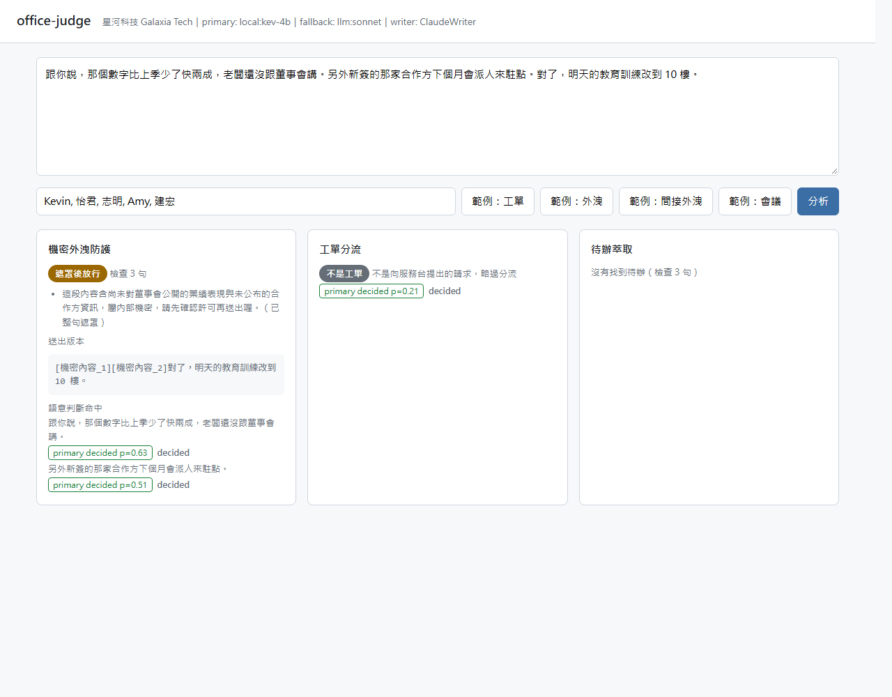
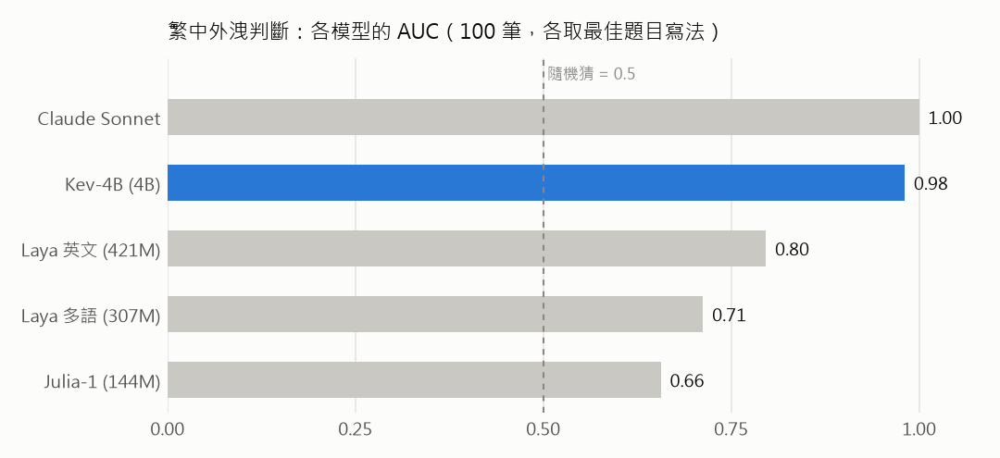

# office-judge

**English** | [繁體中文](README.zh-TW.md)

office-judge reads the emails, chat messages and meeting notes that employees write, and does three jobs on them: it stops messages that leak confidential information, sends support tickets to the right team, and pulls out action items. It works in Traditional Chinese.

Each decision is a yes/no or pick-one question put to a "judge". The judge is a chain: cheap rules first, then a small decision model (Jev or the open Kev-4B), then a general LLM (Claude) for the cases the small model is unsure about, then a human review queue. This chain lives in `judge-core`, a small library inside this repo.



## Results

These are for leak detection (DLP, data loss prevention) on Traditional Chinese text. All company data is fictional, and both the messages and their labels were written by an LLM.

| | Result |
|---|---|
| Whole chain (rules, Kev-4B, Claude, human), 100 held-out messages | 0 of 56 leaks missed, accuracy 0.93, 42% of sentences needed the LLM |
| Kev-4B threshold tuned on one set, frozen, applied to a new set | accuracy 0.88 (0.89 if re-tuned on the new set), so the threshold carries over |
| Kev-4B latency on an RTX 3060 Ti | p50 62 ms per sentence, fast enough to check a message before the user sends it |
| Small encoder decision models (Julia-1, Laya English and multilingual) | not usable on Traditional Chinese: AUC 0.66-0.80, and the result changes with the wording of the question |

AUC measures how well a model ranks leaks above non-leaks (1.0 is perfect, 0.5 is a coin flip).



Two things I learned that shaped the design:

- A threshold only works for one model and one wording of the question. Kev-4B ranks almost perfectly (AUC 0.98), but its default 0.5 cut-off missed 42% of leaks. Changing a few words in the question moved the probabilities enough to send every sentence to the LLM. So each policy file has per-model `model_thresholds`, and the question text is pinned to the wording the thresholds were tuned on. `scripts/bench_dlp.py` compares models and wordings; its output is in `data/out/bench_dlp.json`.
- Known formats are masked before any model sees the text. Rules catch Taiwan ID, resident certificate (ARC) and company tax ID (UBN) numbers with their checksums, card numbers, phone numbers, API keys and project codenames, and replace them with placeholders that can be turned back. The judge models never receive the real values.

The labels need a human check. `data/out/human_labels.csv` holds 40 sentences for that, and none of them is labelled yet.

## The three jobs

| Job | What it does | How |
|---|---|---|
| Leak check (DLP) | Gates a message | Rules mask known formats first. Then one Jev request judges every sentence. The result is pass, mask (reversible), or block with a reason |
| Ticket routing | Picks a team and an urgency | One Jev request asks which team (a pick-one question, with each team's scope written in the options) and how urgent (a score) |
| Action items | Finds tasks and owners | One Jev request asks, for every sentence, whether it is an action item and who owns it (the attendees, or "unassigned"), with the neighbouring sentences as context. The LLM then only works out deadlines for the sentences that were picked |

Jev is TypeSafe's decision model. It answers many questions in one request and returns a probability for each. Kev-4B and the other open models can serve the same request format through llama.cpp.

The chain for each question:

```
Rule --hit--> decide
  | miss
Jev (all questions in one request) --confident--> decide
  | gray zone
LLM (the gray questions in one request) --confident--> decide
  |
Human queue (a gating question stays blocked until someone reviews it)
```

Every layer writes to a SQLite audit log: input hash, each layer's answer and probability, model version, latency and cost.

## Run it

You need Python 3.11+ and [uv](https://docs.astral.sh/uv/).

```bash
uv sync --extra eval
uv run pytest                                  # 53 tests
uv run uvicorn office_judge.app:app --reload   # http://127.0.0.1:8000
```

With no API key and no local model, the page runs on a keyword heuristic, so you can try the whole flow without any model. The backends are chosen by environment variables:

| Variable | Meaning |
|---|---|
| `TYPESAFE_API_KEY` | Use Jev from TypeSafe as the main judge |
| `TYPESAFE_BASE_URL` | Point at another server that speaks the same format, such as [jev-rs](https://github.com/yijunyu/jev-rs) or llama.cpp, to stay fully local |
| `TYPESAFE_DEFAULT_MODEL` | Default `jev-1.14.0`. Pin a version, because aliases move |
| `OFFICE_JUDGE_PRIMARY` | `jev`, `llm` or `demo`. Default: `jev` if a key or base URL is set, otherwise `demo` |
| `OFFICE_JUDGE_FALLBACK`, `OFFICE_JUDGE_WRITER` | `on` or `off`. The LLM second layer, and the LLM writing block reasons and working out deadlines. Both default to on when the `claude` command is installed |
| `JUDGE_LLM_MODEL` | Model passed to the local Claude Code CLI, default `sonnet` |

The LLM layer runs the local `claude -p` command, so it uses your Claude login and needs no API key.

### Demo with a local model

`./scripts/demo.sh` starts Kev-4B through llama.cpp, then the web app, and opens the page. It uses the GPU if at least 4 GB of VRAM is free, otherwise the CPU (about 1 s per sentence). `./scripts/demo.sh --offline` skips all models and uses the keyword heuristic. The script opens the browser with `cmd.exe`, so it expects Windows or WSL.

`scripts/serve_local.sh` is what starts the models. It does not download anything. It expects:

- llama.cpp server binaries in `.cache/llama/cpu/oj-llama-server.exe` (and `.cache/llama/cuda/llama-server.exe` for the GPU)
- the model files in `~/Desktop/IEKA/.cache/llama/models` (change it with `IEKA_MODELS`), for example `Kev-4B-Q4_K_M.gguf`

To start only Kev-4B and point the app at it:

```bash
KEV_GPU=1 ONLY=kev-4b ./scripts/serve_local.sh &
TYPESAFE_BASE_URL=http://127.0.0.1:8195 TYPESAFE_DEFAULT_MODEL=kev-4b uv run uvicorn office_judge.app:app
```

On this data only Kev-4B was usable, so its thresholds are in `src/office_judge/policies/dlp.yaml` under `model_thresholds`.

## Evaluate

```bash
uv run python scripts/toy_eval.py                                # threshold sweep + calibration on 20 hand-labelled rows
uv run python scripts/toy_eval.py --backends jev llm --cascade   # compare backends, report the LLM rescue rate
uv run python scripts/jev_checks.py                              # Jev checks: Traditional Chinese, batching, option order
uv run python scripts/gen_data.py dlp --n 300                    # make synthetic labelled data (fictional company)
uv run python scripts/validate_pipeline.py --data data/out/dlp_val.jsonl   # run held-out rows through the whole chain
```

The LLM rescue rate is the share of gray-zone items where the LLM overruled Jev and was right. Measure it before you rely on the LLM layer: if both models tend to fail on the same items, the second layer adds little.

## Layout

```
src/judge_core/      Judge interface, Jev / LLM / Rule / Human / Fake backends, cascade, policies, audit, eval
src/office_judge/    detectors, text handling (sentence split, reversible masking), the three jobs,
                     policies/*.yaml, company.yaml, web app
scripts/             demo.sh, serve_local.sh, toy_eval, jev_checks, gen_data, bench_dlp, validate_dlp, validate_pipeline
data/toy_dlp.jsonl   20 hand-labelled sentences
data/out/            100-message tuning and validation sets, benchmark output, the human-labelling sheet
```

All company names, people and personal data are fictional.
