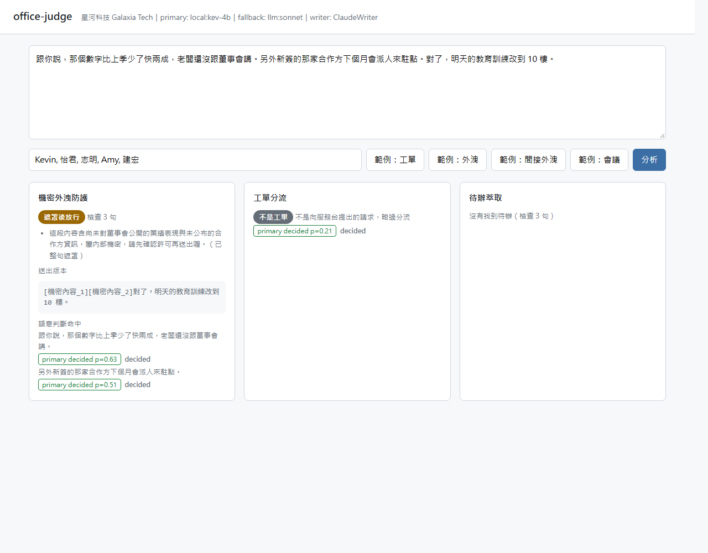
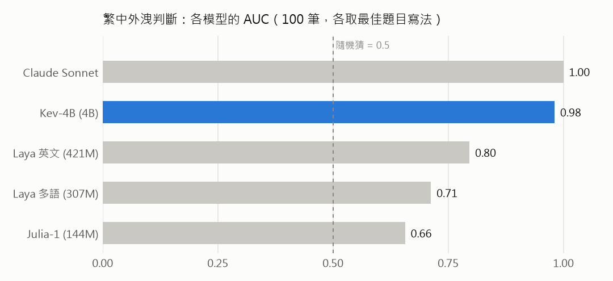

# office-judge

[English](README.md) | **繁體中文**

把員工每天寫的信件、訊息、會議記錄自動分流工單、擋下機密外洩、抓出待辦。底層是 **judge-core**：一個把 Jev（TypeSafe 的 System One 模型）、LLM、確定性規則和人工審核佇列放在同一個介面後面、依信心串接的小函式庫。

計畫：[PLANS.md](PLANS.md) · [00 共用核心](00-shared-core.md) · [02 office-judge](02-office-judge-plan.md)



## 成果（繁中外洩防護，虛構公司資料）

| | 結果 |
|---|---|
| 完整管線（規則 → Kev-4B → Claude → 人工），100 則獨立驗證訊息 | **56 則外洩全部攔下**，準確率 0.93，42% 的句子需要問 LLM |
| Kev-4B 門檻在一份資料上調好、凍結，套到新資料 | 準確率 0.88（在新資料上重調也只有 0.89）：門檻可以沿用 |
| Kev-4B 在 RTX 3060 Ti 上的延遲 | 每句 p50 62 ms，可以在使用者按下送出前完成檢查 |
| 小型 encoder decision model（Julia-1、Laya 英文版／多語版） | 繁中不可用：AUC 0.66–0.80，而且換個題目寫法結果就變 |



改變設計的發現：
- **門檻要依模型、依題目寫法分別設定。** Kev-4B 排序幾乎完美（AUC 0.98），用預設 0.5 卻漏放 42%；題目改幾個字，機率就偏移到每句都送 LLM。所以 policy 有 `model_thresholds`，題目也固定成驗證過的寫法。
- **已知格式先遮罩，模型永遠看不到。** 台灣身分證／居留證／統編（含檢查碼）、信用卡、手機、金鑰、專案代號由規則抓出，換成可還原的 placeholder 再送判斷。
- 注意：資料與標註由 LLM 合成，人工標註的抽樣檢查進行中。

## 功能

| 管線 | 角色 | 做法 |
|---|---|---|
| 機密外洩防護 | 把關 | 先用規則（台灣身分證／居留證／統編含檢查碼、信用卡、手機、API 金鑰、專案代號）遮罩已知格式，再用一次 Jev 請求逐句判斷。結果：放行／遮罩後放行（可還原）／擋下並說明原因 |
| 工單分流 | 分流＋排序 | 一次 Jev 請求同時問團隊（choice，負責範圍寫在選項說明）和急迫度（score） |
| 待辦萃取 | 萃取 | 一次 Jev 請求對每一句同時問「是不是待辦」和「負責人」（與會者＋未指定），附前後句當上下文。LLM 只處理被挑出的句子，換算期限 |

```
Rule ──命中──▶ 決策
  ↓ 沒命中
Jev（所有問題一次送）──信心夠──▶ 決策
  ↓ 灰色地帶
LLM（灰色的問題一次送）──信心夠──▶ 決策
  ↓
人工佇列（把關類在審核前維持擋下）
```

每一層都寫進 SQLite 稽核紀錄：輸入雜湊、各層答案與機率、模型版本、延遲、成本。

## 快速開始

一個指令啟動現場 demo（Kev-4B＋Claude＋網頁；`--offline` 不需要任何模型，用關鍵字規則模擬）：

```bash
./scripts/demo.sh
```

或分步驟：

```bash
uv sync --extra eval
uv run pytest
uv run uvicorn office_judge.app:app --reload   # http://127.0.0.1:8000
```

沒有 API key 時，demo 會用關鍵字規則模擬判斷，整個流程一樣可以試。後端由環境變數決定：

| 變數 | 說明 |
|---|---|
| `TYPESAFE_API_KEY` | 用 Jev 當主要判斷 |
| `TYPESAFE_BASE_URL` | 指向 [jev-rs](https://github.com/yijunyu/jev-rs) 伺服器，變成完全本地的後端（協定相同） |
| `TYPESAFE_DEFAULT_MODEL` | 預設 `jev-1.14.0`；alias 會移動，請綁定版本 |
| `OFFICE_JUDGE_PRIMARY` | `jev`／`llm`／`demo` |
| `OFFICE_JUDGE_FALLBACK`、`OFFICE_JUDGE_WRITER` | `on`／`off`。LLM 第二層，以及由 LLM 撰寫擋下理由和換算期限。有安裝 `claude` CLI 時預設開啟 |
| `JUDGE_LLM_MODEL` | 本機 Claude Code CLI 使用的模型，預設 `sonnet` |

LLM 後端呼叫本機的 `claude -p` CLI（訂閱登入，不需要 API key）。

### 本地 decision model（llama.cpp）

`llama-server` 原生支援 `/v1/systemone`，開源 decision model 透過 `TYPESAFE_BASE_URL` 就能接上。在繁中外洩防護資料上只有 **Kev-4B** 堪用（驗證結果：規則 → Kev-4B → Claude 端到端 56 則外洩沒有漏放；見 `00-shared-core.md` 第 8 節）。它的門檻寫在 `policies/dlp.yaml` 的 `model_thresholds`。

```bash
KEV_GPU=1 ONLY=kev-4b ./scripts/serve_local.sh &
TYPESAFE_BASE_URL=http://127.0.0.1:8195 TYPESAFE_DEFAULT_MODEL=kev-4b uv run uvicorn office_judge.app:app
```

## 評估

```bash
uv run python scripts/toy_eval.py                        # 20 筆玩具資料：閾值掃描＋校準曲線
uv run python scripts/toy_eval.py --backends jev llm --cascade   # 比較後端、LLM 救援率
uv run python scripts/jev_checks.py                      # Jev 第一天實測：繁中、合併送出、選項順序
uv run python scripts/gen_data.py dlp --n 300            # 虛構公司的合成標註資料
```

**LLM 救援率**：灰色地帶裡 LLM 推翻 Jev 且推翻正確的比例。已發表的研究指出 Jev 和 LLM 常錯在同一處，所以依賴 LLM 這一層之前要先量。

## 目錄

```
src/judge_core/      Judge 介面、Jev／LLM／Rule／Human／Fake 後端、串接、Policy、稽核、評估
src/office_judge/    偵測器、文字處理（斷句、可還原遮罩）、三條管線、policies/*.yaml、company.yaml、網頁
scripts/             toy_eval、jev_checks、gen_data
data/toy_dlp.jsonl   20 筆人工標註句子
```

所有公司、人名與個資皆為虛構。
